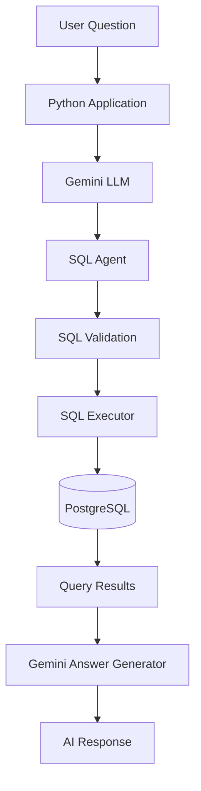

# ✈️ AeroOps AI – AI-Powered Operations & Data Intelligence Copilot


## 🚀 Project Overview

**AeroOps AI** is a Generative AI-powered application that simplifies aviation data analysis using Python, FastAPI, PostgreSQL, and Google Gemini.

It allows users to ask questions in natural language instead of manually writing SQL queries. The application converts questions into SQL, retrieves data from PostgreSQL, and generates easy-to-understand AI responses.

The long-term goal is to develop an Agentic AI Operations Copilot for data quality monitoring, ETL incident investigation, and operational analytics.

## ✨ Key Features

- **Flight Data Ingestion:** Loads CSV data into PostgreSQL using Python.
- **Data Quality Checks:** Validates record counts, NULL values, duplicates, and invalid records.
- **Generative AI Integration:** Uses Google Gemini to understand user questions and generate responses.
- **Natural Language to SQL:** Converts user questions into PostgreSQL SELECT queries.
- **SQL Execution:** Validates and executes generated queries against PostgreSQL.
- **FastAPI Backend:** Exposes application functionality through REST APIs and Swagger documentation.

## 🏗️ Architecture



## 🛠️ Technology Stack

| Category | Technologies |
|---|---|
| Programming | Python |
| Backend | FastAPI, REST APIs |
| Database | PostgreSQL, SQL |
| Generative AI | Google Gemini API, LLMs |
| AI Concepts | Prompt Engineering, Natural Language to SQL |
| Data Processing | CSV, Python |
| Tools | VS Code, Git, GitHub, Swagger |

**Planned Technologies:** LangGraph, LangChain, RAG, ChromaDB, Docker, AWS, and Pytest.

## 🧠 Technical Skills Demonstrated

- Python programming and modular development.
- FastAPI and REST API development.
- PostgreSQL and SQL query execution.
- CSV data ingestion and data quality validation.
- Generative AI and LLM integration.
- Prompt engineering and Natural Language to SQL.
- Git and GitHub version control.

## 📂 Project Structure

```text
AeroOps-AI/
│
├── data/
│   └── flights.csv
│
├── app.py
├── database.py
├── flight_data.py
├── flight_ai.py
├── llm.py
├── sql_agent.py
├── sql_executor.py
├── answer_generator.py
├── load_data.py
├── test_complete_flow.py
├── .gitignore
├── requirements.txt
└── README.md
```

## ▶️ Setup and Run

**1. Clone the repository**

```bash
git clone https://github.com/AkshataTodmal33/AeroOps-AI.git
cd AeroOps-AI
```

**2. Create and activate a virtual environment**

```bash
python -m venv venv
```

Windows PowerShell:

```powershell
.\venv\Scripts\Activate.ps1
```

**3. Install dependencies**

```bash
pip install -r requirements.txt
```

**4. Configure your `.env` file**

```env
GEMINI_API_KEY=your_gemini_api_key
```

Configure your local PostgreSQL database in `database.py` and load the flight data.

**5. Run the FastAPI application**

```bash
uvicorn app:app --reload
```

Open Swagger documentation:

http://127.0.0.1:8000/docs

To run the AI-powered SQL workflow:

```bash
python test_complete_flow.py
```

## 💬 Example Use Case

**User Question:**

Which flight has the highest delay?

**AI-Generated Answer:**

The flight with the highest delay is Air India flight AI103 from DEL to BLR, with a delay of 60 minutes.

## 🗺️ Project Roadmap

**Completed**
- [x] Python and PostgreSQL integration.
- [x] CSV data ingestion.
- [x] Data quality validation.
- [x] FastAPI backend.
- [x] Gemini LLM integration.
- [x] Natural Language to SQL.
- [x] SQL execution and AI-generated responses.

**Upcoming**
- [ ] RAG implementation.
- [ ] Multi-agent architecture using LangGraph.
- [ ] Data Quality and ETL Incident Investigation Agents.
- [ ] Docker containerization.
- [ ] AWS deployment.
- [ ] LLM evaluation and monitoring.

## 🔗 Useful Links

- **GitHub Repository:** [AeroOps-AI](https://github.com/AkshataTodmal33/AeroOps-AI)
- **GitHub Profile:** [AkshataTodmal33](https://github.com/AkshataTodmal33)
- **API Documentation:** `http://127.0.0.1:8000/docs` (available locally)
- **Live Demo:** Coming Soon

## 👩‍💻 Author

**Akshata Sunil Todmal**

Software Engineer | AWS & Data Engineering | Generative AI Enthusiast

**Interests:** Python | Generative AI | Agentic AI | AWS | Data Engineering

[GitHub Profile](https://github.com/AkshataTodmal33)

---

⭐ **AeroOps AI – Bringing Generative AI and Data Engineering Together.**


